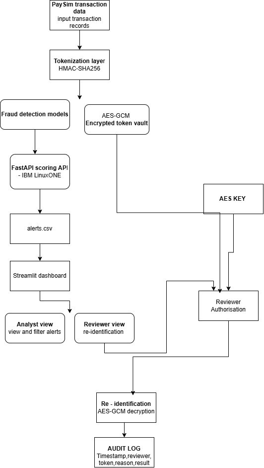

# The STARK Paradox: privacy-preserving fraud detection on IBM LinuxONE

IBM Z Datathon 2026 | Track: AI Secured: Innovation Without Exposure | Event code: SSF2026

Fraud models need transaction data, but the people and tools that touch that data should never see real customer identities. The STARK Paradox scores transactions for fraud using only tokenized identifiers. Real IDs live in a separate encrypted vault that only a named reviewer, with a written reason, can open, and every opening is logged.

## Architecture



Editable source: `docs/architecture.drawio`.

1. Raw customer and account IDs are replaced by tokens (`TK_` + 16 hex characters of HMAC-SHA256) before anything else sees them.
2. Features are computed from tokens only. The XGBoost model never receives a raw ID.
3. A scoring API (FastAPI, in a Docker container on IBM LinuxONE) returns `{tx_id, risk_score, top_reason}`.
4. The top alerts go to an analyst dashboard that shows tokens only.
5. Original IDs for alerted tokens are stored AES-GCM encrypted. A reviewer must enter a name and a reason to decrypt one, and each decryption writes an audit line (token only, never the raw ID).

## Results (PaySim, time-based split)

| Item | Value |
|---|---|
| Dataset | PaySim, 6,362,620 synthetic transactions, 8,213 fraud (0.13%) |
| Modelled rows | 2,770,409 (TRANSFER and CASH_OUT only, the only types that contain fraud) |
| Train (step <= 600) | 2,726,859 rows, 6,613 fraud |
| Test (step > 600) | 43,550 rows, 1,600 fraud (3.7%) |
| Model | XGBoost, 200 trees, depth 6, scale_pos_weight=50 |
| ROC-AUC | 0.932 |
| PR-AUC | 0.693 (optimistic, see limits) |

Alert budget on the test window (an analyst reviews the N highest-risk transactions):

| Alerts reviewed | Precision | Recall |
|---|---|---|
| 100 | 1.000 | 0.062 |
| 300 | 0.997 | 0.187 |
| 600 | 0.972 | 0.364 |
| 1,000 | 0.799 | 0.499 |
| 2,000 | 0.548 | 0.685 |

**Privacy costs no accuracy.** Every model input computed from raw IDs is identical to the same input computed from tokens (same row order, `numpy.allclose` is True), because tokenization is a one-to-one mapping and the features only count and sum per receiver. A model trained on either sees the same data.

## Running on IBM LinuxONE

| Item | Value |
|---|---|
| Platform | IBM LinuxONE Community Cloud, architecture s390x (Big Endian), machine type 9175 |
| OS and size | Ubuntu 24.04.5 LTS, 3 CPUs, 8 GB RAM |
| Containers | `stark-scoring-api:2.0` (our API) and the IBM-provided JupyterLab image |
| In-process scoring | about 4 ms per transaction |
| API latency | p50 4.0 ms, p95 4.9 ms, p99 7.3 ms (1,000 sequential requests, one client, localhost, includes HTTP) |
| IBM labs | both mandatory labs completed on this instance (screenshots in `docs/evidence/`) |

The IBM image includes a zDNN plugin. Our model is XGBoost on CPU, and we make no claim about NNPA acceleration.

## Repository layout

| Path | What it is |
|---|---|
| `pipeline/01_tokenize.ipynb` | tokenization, vault, features, model, alert budget, export |
| `pipeline/scorer.py` | scoring function (tokenize first, then features, then score and reason) |
| `pipeline/vault.py` | reviewer re-identification with audit logging |
| `infra/api/` | FastAPI service, Dockerfile, latency test, model and receiver-history state |
| `dashboard/` | analyst and reviewer dashboard |
| `tests/leak_test.py` | fails if any raw-looking ID appears in a file, log or API reply |
| `docs/` | architecture, demo script, evidence screenshots |

## How to run

Scoring API (needs the tokenization key, which is not in the repository):

```bash
docker build -t stark-scoring-api:2.0 infra/api
docker run -d --name stark-scoring-api --user "$(id -u):$(id -g)" -p 127.0.0.1:8000:8000 \
  --mount type=bind,src=/path/to/hmac.key,dst=/run/secrets/hmac.key,readonly stark-scoring-api:2.0
curl -s -X POST http://127.0.0.1:8000/score -H 'Content-Type: application/json' \
  -d '{"tx_id":"T1","customer_id":"C1","counterparty_id":"M1","amount":9500000,"type":"CASH_OUT","step":300}'
```

The API accepts TRANSFER and CASH_OUT only and returns 400 for other types. `infra/api/state.json` holds receiver history under our key. With a different key the API still runs but starts with empty receiver history.

Dashboard: see `docs/README.md`. Leak test: `python tests/leak_test.py dashboard/sample_alerts.csv`.

## Data decisions and honest limits

- **Synthetic data.** PaySim is simulated, so results show the method works, not how it performs on a real bank.
- **Balance columns and `isFlaggedFraud` are excluded.** In PaySim, fraudulent transactions are cancelled, so the balance columns leak the answer.
- **Test window is small and fraud-rich.** The test window (last steps) has 3.7% fraud against 0.13% overall, so precision numbers are optimistic. ROC-AUC does not depend on the fraud rate.
- **Scores are for ranking.** The model uses scale_pos_weight=50, so risk scores are not calibrated probabilities. Choose an operating point from the alert-budget table, not a 0.5 cutoff.
- **Time of day is partly a simulation effect.** The `hour` feature has importance 0.225, and "Unusual time of day" is the stated reason on 553 of the top 1,000 alerts. We expect this to reflect how PaySim was generated.
- **Reasons are only meaningful for high-risk alerts.** The reason is the largest contributing feature, so on low scores it is not an explanation.
- **Roles are a demo.** The dashboard's Analyst and Reviewer roles are a selector, not production authentication.
- **Cold-start receivers.** In our probes a TRANSFER to a never-seen receiver scored 0.57 to 0.83 for amounts from 10 to 100,000, while a CASH_OUT to a never-seen receiver scored 0.03 to 0.09. This is what the model learned from PaySim.
- **Vault scope.** Only IDs that appear in alerts are stored in the vault, not all 5 million IDs.

## Open-source libraries

| Library | Use | License |
|---|---|---|
| [XGBoost](https://github.com/dmlc/xgboost) | fraud model | Apache-2.0 |
| [scikit-learn](https://scikit-learn.org) | metrics | BSD-3-Clause |
| [pandas](https://pandas.pydata.org) and [NumPy](https://numpy.org) | data processing | BSD-3-Clause |
| [PyCryptodome](https://www.pycryptodome.org) | AES-GCM vault | BSD-2-Clause |
| [FastAPI](https://fastapi.tiangolo.com) and [Uvicorn](https://www.uvicorn.org) | scoring API | MIT and BSD-3-Clause |
| [Streamlit](https://streamlit.io) | dashboard | Apache-2.0 |
| [diagrams.net](https://www.drawio.com) | architecture diagram | tool only |

Dataset: [PaySim on Kaggle](https://www.kaggle.com/datasets/ealaxi/paysim1) (see the page for its license). Platform: IBM LinuxONE Community Cloud and IBM's provided JupyterLab image.

## Team

Team: **The STARK Paradox** | IBM Z Datathon 2026 | Event code: SSF2026
